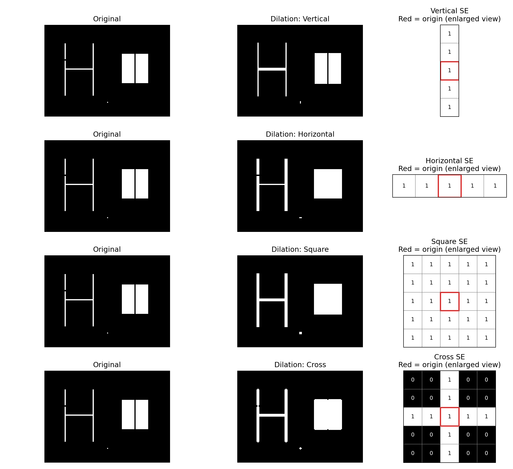
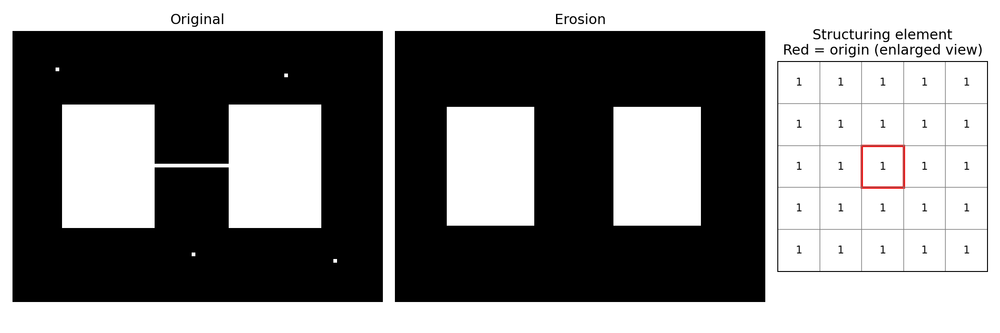
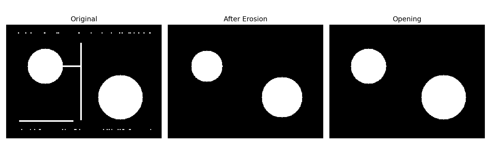
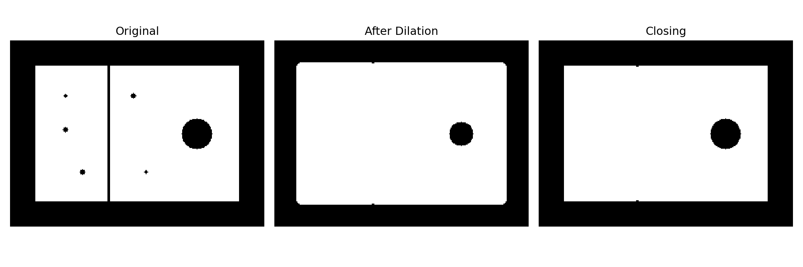

# 형태학적 이미지 처리 (Morphological Image Processing)

이진 이미지에 대해 **Dilation / Erosion / Opening / Closing**을 직접 구현한 컴퓨터비전 과제입니다.
각 Python 파일은 **독립적으로 실행 가능**하며, OpenCV 또는 SciPy의 완성된 morphology 연산을 호출하지 않습니다.
예제 원본은 각 연산의 차이를 뚜렷하게 확인할 수 있도록 코드에서 생성합니다.

## 연산과 처리 전후 비교

| 연산 | 수행 과정 | 관찰 결과 |
|---|---|---|
| Dilation (팽창) | 구조 요소가 물체와 하나라도 겹치면 픽셀을 1로 설정 | 흰 물체가 확장되고 가까운 선이나 간격이 연결됨 |
| Erosion (침식) | 구조 요소의 활성 위치가 모두 물체에 포함되어야 픽셀을 1로 설정 | 흰 물체가 축소되고 작은 잡음이나 가는 연결부가 제거됨 |
| Opening (열림) | Erosion → Dilation | 작은 흰 점과 가는 선이 제거되고 비교적 큰 물체는 유지됨 |
| Closing (닫힘) | Dilation → Erosion | 작은 검은 구멍 및 좁은 틈이 메워지고 물체의 큰 형태는 유지됨 |

**Dilation — 여러 구조 요소 비교**



**Erosion — 물체 축소**



**Opening — 침식 후 팽창, 잡음 제거**



**Closing — 팽창 후 침식, 틈과 구멍 채우기**



## 폴더 구성

- `01_dilation.py`: 4종류 구조 요소(수직/수평/정사각형/십자) 비교
- `02_erosion.py`: 침식과 작은 잡음 제거
- `03_opening.py`: 침식 → 팽창 및 중간 단계 이미지
- `04_closing.py`: 팽창 → 침식 및 중간 단계 이미지
- `results/<연산명>/original.png`: 각 연산에 사용한 원본
- `results/<연산명>/result.png`: 각 연산의 최종 결과 (`dilation`은 구조 요소별 결과 이미지)
- `results/<연산명>/comparison.png`: 원본과 결과 비교
- `results/opening/process.png`, `results/closing/process.png`: 단계별 변화

## 실행 방법

Python 3.10 이상의 환경에서:

```bash
python -m pip install -r requirements.txt
python 01_dilation.py
python 02_erosion.py
python 03_opening.py
python 04_closing.py
```

실행하면 각 연산의 `results/` 하위 폴더에 PNG 파일이 저장됩니다.
본 저장소에는 네 프로그램을 직접 실행하여 생성한 PNG 결과가 이미 포함되어 있습니다.
